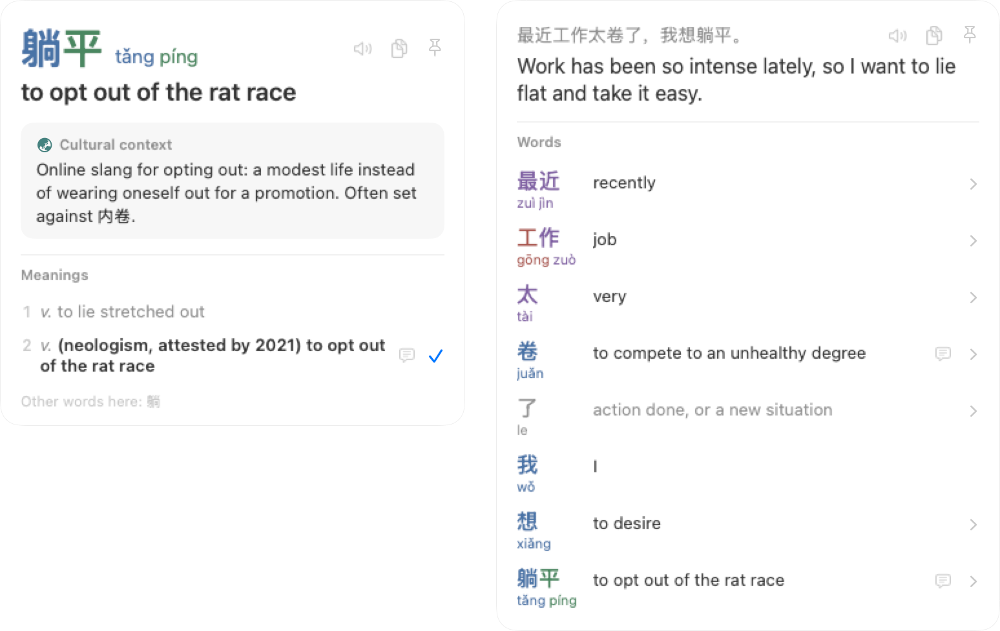

<p align="center">
  
</p>

<h1 align="center">Longyan Reader</h1>

<p align="center">A pop-up Chinese reader for the Mac that understands the sentence you're reading.</p>

<p align="center">
  <a href="https://github.com/mapuchuu/longyan-reader/releases/latest/download/LongyanReader.zip"><b>Download for Mac</b></a>
  &nbsp;·&nbsp;
  <a href="https://longyan.app">Try it in your browser</a>
</p>

<p align="center">
  <a href="https://github.com/mapuchuu/longyan-reader/releases/latest"></a>
  <a href="https://github.com/mapuchuu/longyan-reader/releases"></a>
  
  <a href="LICENSE"></a>
</p>

<br>

<p align="center">
  
</p>

Highlight Chinese in Safari, Chrome, Preview, Mail or almost any other app, and a card opens with what each word means in that sentence. Instead of every definition the word has ever had, you see the one the writer meant, with pinyin, a translation of the whole phrase, and a note when the word carries more than its gloss can say.

It takes about a tenth of a second, and it all happens on your Mac. The language model runs on your own GPU, so nothing you read leaves your computer. There's no account and nothing to pay for.

## One sentence, two answers

最近工作太卷了，我想躺平. *Work has been so intense lately, I just want to lie flat.*

Look up 躺平 in a dictionary and you get "to lie stretched out" and "to opt out of the rat race", in that order. Longyan reads the sentence, picks the second, and tells you it's online slang usually set against 内卷.

<p align="center">
  <picture>
    <source media="(prefers-color-scheme: dark)" srcset="docs/media/cards-1-dark.png">
    
  </picture>
</p>

## What it does

Select a single word and you get its meaning in context, pinyin colored by tone, and the dictionary's other senses underneath in case you want them. Select a phrase or a whole sentence and you get a natural translation first, then every word in it with its meaning there. Any word can be opened to see the rest of its senses or to pick a different one yourself.

Meanings always come from CC-CEDICT, so the model chooses between real dictionary entries and never invents one. On top of that sit 1,040 notes, written ahead of time and checked by hand, on the words where a gloss falls short: 面子, 关系, 内卷, 摸鱼, 正能量 and a thousand more.

Every lookup goes into a history with its sentence and the meaning the word had there. You can search it or export it to Anki or a spreadsheet.

The app lives in the menu bar. Cards follow light and dark mode, use Liquid Glass on macOS 26, and can be dragged, pinned and zoomed. Everything runs from one shortcut, ⌃⌥L.

## How well it works

On 175 lookups taken from real reading, Longyan picked the right meaning 168 times. A single word takes about 0.12 seconds, a whole phrase about 0.3.

That's because it ships its own model rather than leaning on Apple Intelligence. We tested both, along with other sizes of Qwen, on 52 held-out sentences where the right meaning comes with a note:

| Model | Right | Wrong notes | Per lookup |
|---|---|---|---|
| **Qwen 3.5 4B, built in** | **51 of 52** | **1** | **0.15 s** |
| Qwen 3.5 9B | 51 of 52 | 0 | 0.62 s |
| Apple Intelligence 3B | 38 of 52 | 5 | 0.55 s |
| Qwen 3.5 2B | 35 of 52 | 2 | 0.18 s |

The 4B model was as accurate as one twice its size and four times faster. Measured on 2026-11-19 on an M5 Pro. `scripts/evals.sh` runs every test, and [DEVELOPMENT.md](DEVELOPMENT.md#the-model) explains the method and what else was tried.

## Install

1. [Download the zip](https://github.com/mapuchuu/longyan-reader/releases/latest/download/LongyanReader.zip), unzip it, and drag **Longyan Reader** to your Applications folder.
2. Open it. macOS asks if you're sure, since it came from the internet. Click **Open**.
3. When the app asks, turn on Longyan Reader under Privacy & Security > Accessibility. It needs this to read the text you highlight.
4. Download the reading model when it's offered (2.7 GB), or click **Later** and get it from the menu bar any time.

Or install it with [Homebrew](https://brew.sh):

```sh
brew install mapuchuu/tap/longyan-reader
```

Then open it and carry on from step 2. Either way the app is signed and notarized by Apple, and it keeps itself up to date.

Updating from 0.1? 1.0 is signed differently. If the app asks for Accessibility again after the update, turn it on again. If it already looks on, switch it off and on.

You'll need a Mac with Apple silicon running macOS 15 or later, and about 4 GB of free space for the model download. The app itself is 34 MB.

## Using it

Highlight some Chinese, with a drag or a double-click, and a small eye appears beside it. Click the eye, or press **⌃⌥L**. With nothing highlighted, ⌃⌥L looks up the word under the pointer. Right-click the eye to hide it in that app or turn it off; ⌃⌥L keeps working either way.

Press Escape to close a card. Drag its bottom-right corner to make the text bigger or smaller, and double-click the corner to reset it. Your lookups are under **Lookup History** in the menu bar icon's menu.

### The reading model

Meanings and translations come from Qwen 3.5 4B (Apache 2.0), running through llama.cpp and Metal. The app offers to download it the first time you open it, and it stays under **Download Reading Model** in the menu after that. If you already have `qwen3.5:4b` in [Ollama](https://ollama.com), the app uses that copy instead.

Without the model you still get the dictionary, pinyin and notes, with meanings in dictionary order. On macOS 26 with Apple Intelligence turned on, Apple's model picks meanings and translates phrases instead, less accurately.

## Privacy

Nothing you look up is ever sent anywhere. The app goes online for three things only: downloading the reading model when you ask (a plain file from hf-mirror.com, or huggingface.co if that fails, checked against its SHA-256), checking GitHub for updates once you've agreed to it (nothing about your Mac is sent), and Report a Problem, which opens a pre-filled GitHub issue in your browser and sends nothing until you submit it.

Your history stays in `~/Library/Application Support/LongyanReader/History` unless you export it. Keep 30 days, turn it off, or clear it under **Keep History** in the menu. The [privacy page](https://longyan.app/privacy.html) has the details.

## Under the hood

When you click the eye, the app asks the frontmost app for the selection and the paragraph around it through the Accessibility API. That works in native apps, web views, Chrome and Electron; apps that won't share their selection get a copy-and-restore fallback that leaves your clipboard as it was.

The dictionary ships compiled into a sorted binary file that's searched in place, so it opens in about 3 ms instead of 1.4 seconds of parsing. The model sees the sentence and the dictionary's numbered meanings, and each pick is read straight from its probabilities for the next token, one pass per word instead of generated text. Translations stream in as they're written, limited to the 67,535 tokens found in the dictionary's English. Work starts the moment the eye appears, so the card is often ready before you've clicked.

[DEVELOPMENT.md](DEVELOPMENT.md) covers all of it, including how to build the app.

## The name

*Longyan* is 龙眼, "dragon eye", the Chinese name for the longan fruit. The eye in the icon is the same one that appears beside your selection.

## FAQ

<details>
<summary><b>Does it work on Intel Macs, Windows or iPhone?</b></summary>

No. It needs a Mac with Apple silicon and macOS 15 or later, which is what lets the model run this fast.
</details>

<details>
<summary><b>Does it need the internet?</b></summary>

Only to download the reading model once, and for update checks if you turn them on. Lookups work offline.
</details>

<details>
<summary><b>Why does it need Accessibility?</b></summary>

It's how a Mac app reads text selected in another app, along with the sentence around it. Longyan only reads it when you click the eye or press ⌃⌥L.
</details>

<details>
<summary><b>Does it read traditional characters?</b></summary>

Yes, traditional and simplified both work.
</details>

<details>
<summary><b>A meaning was wrong. What should I do?</b></summary>

Choose **Report a Problem** in the menu, or open a [wrong meaning issue](https://github.com/mapuchuu/longyan-reader/issues/new?template=wrong-meaning.yml). Include the sentence and the word; most wrong meanings can only be fixed with the sentence.
</details>

<details>
<summary><b>The app quit, or something else broke</b></summary>

Choose **Report a Problem** from the menu bar icon. If the app quit on its own, macOS kept a crash report: open Console, choose Crash Reports, find LongyanReader and attach the newest one. The app keeps no other log, and your history is never part of a report unless you paste from it.
</details>

<details>
<summary><b>How do I uninstall it?</b></summary>

If you installed it with Homebrew, `brew uninstall --zap longyan-reader` removes the app and everything below. Otherwise, quit the app, then move these to the Trash:

- **Longyan Reader** in Applications
- `~/Library/Application Support/LongyanReader` (the reading model and your history)
- `~/Library/Logs/LongyanReader`, if it's there (history from before 1.0)
- anything named `LongyanReader` or `com.mapuchuu.longyanreader` in `~/Library/Caches` and `~/Library/HTTPStorages`

Then remove it from System Settings > Privacy & Security > Accessibility, and from System Settings > General > Login Items & Extensions if you turned on Open at Login. Its settings go with `defaults delete com.mapuchuu.longyanreader` in Terminal.
</details>

## Contributing

Reports of wrong meanings help more than anything else. Issues and pull requests are welcome; see [CONTRIBUTING.md](CONTRIBUTING.md).

## License

The code is MIT licensed. The dictionary is [CC-CEDICT](https://cc-cedict.org/), © MDBG and contributors, under [CC BY-SA 4.0](https://creativecommons.org/licenses/by-sa/4.0/); the app's dictionary files and the notes, examples and cues in `Resources/` (which quote its definitions) are derived from it and use the same license. Word frequencies in `notes/frequency.txt` come from [jieba](https://github.com/fxsjy/jieba) (MIT). The app also includes [llama.cpp](https://github.com/ggml-org/llama.cpp) and [Sparkle](https://sparkle-project.org), both MIT. The Qwen model is downloaded separately and is Apache 2.0.

Meanings and translations come from a language model and can be wrong. The notes were written by Claude and checked against the dictionary.
