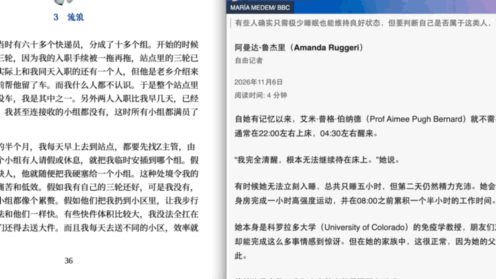
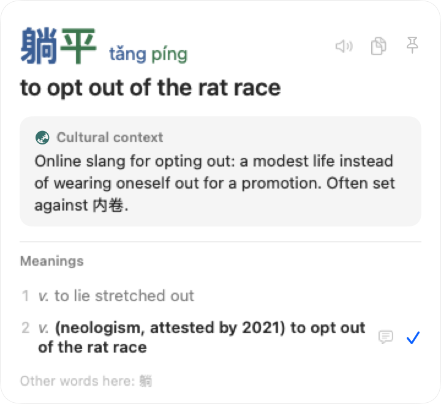
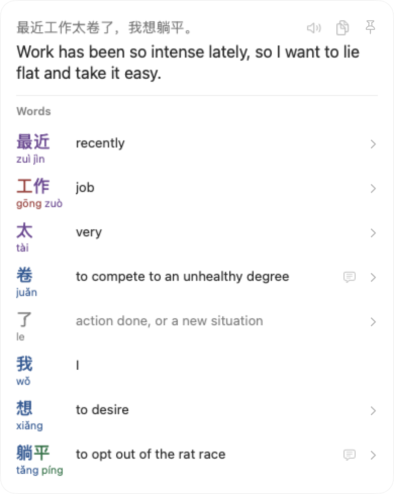
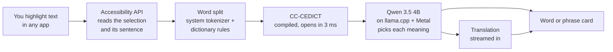

  

<h1 align="center">Longyan Reader</h1>

<b>Highlight Chinese in any Mac app. See what each word means in that sentence.</b> 
Not every meaning the dictionary has: the one the writer meant, with pinyin, a translation and notes on slang and nuance.

  
  
  
  
  
  
  

  <a href="https://github.com/mapuchuu/longyan-reader/releases/latest/download/LongyanReader.zip"><b>Download for Mac</b></a> · <a href="https://longyan.app">longyan.app</a> · Free · open source · macOS 15 or later · Apple silicon

  
   <a href="https://longyan.app">Watch the full demo, or try it in your browser, on longyan.app</a>

A dictionary gives you every meaning a word has and leaves you to guess. Longyan Reader reads the sentence the word is in and shows the one that fits, in about a tenth of a second, in Safari, Chrome, Preview, Mail, Notes, Pages, PDFs and most other apps. Highlight a phrase and you get a translation and every word's meaning in context. Words that English can't carry, like 面子, 内卷 or 躺平, come with a short note on how they're really used.

Everything runs on your Mac, with a language model chosen and tested for the job. No account, no API key, no subscription, and nothing you read leaves your computer.

## What a dictionary shows, and what Longyan shows

**最近工作太卷了，我想躺平。** *"Work has been so intense lately, I want to lie flat and take it easy."*

| | 躺平 |
|---|---|
| A dictionary | 1. to lie stretched out 2. (neologism, attested by 2021) to opt out of the rat race |
| Longyan Reader | **to opt out of the rat race**, with a note: *Online slang for opting out: a modest life instead of wearing oneself out for a promotion. Often set against 内卷.* |

  <picture>
    <source media="(prefers-color-scheme: dark)" srcset="docs/media/word-card-1-dark.png">
    
  </picture>
  &nbsp;
  <picture>
    <source media="(prefers-color-scheme: dark)" srcset="docs/media/phrase-card-1-dark.png">
    
  </picture>

## Features

- **The meaning that fits.** A model reads the whole sentence and picks from the dictionary's own meanings. It never makes up a definition.
- **Phrases and whole sentences.** Highlight more than a word for a natural translation, then every word with its meaning. Click any word to see its other meanings or pick a different one.
- **Notes where the gloss falls short.** 1,040 hand-checked notes on slang, tone and usage: who says it, when, and how it lands. 关系, 面子, 内卷, 摸鱼, 正能量.
- **Works where you read.** Web pages, PDFs, ebooks, email, documents and chat apps. If an app won't share its selection, Longyan copies it and puts your clipboard back.
- **Pinyin in tone colors**, so you start to hear a word as you read it. One click plays it aloud.
- **A history of what you looked up**, with the sentence and the meaning each word had there. Search it, or export it to Anki or a spreadsheet.
- **Fast.** Work starts the moment you highlight, so the card is often filled in when it opens. The model unloads after five minutes without a lookup.
- **Made for the Mac.** A menu bar app with Liquid Glass on macOS 26, light and dark cards, cards you can drag, pin and zoom, and one shortcut: **⌃⌥L**.

## By the numbers

| | |
|---|---|
| **96%** | of meanings picked right on 175 lookups from real reading |
| **98%** | of notes shown where they belong (51 of 52 held-out cases) |
| **0.12 s** | to pick a single word's meaning; a whole phrase takes about 0.3 s |
| **125,274** | dictionary entries (CC-CEDICT) |
| **1,040** | hand-checked notes on slang, tone and usage |
| **0 bytes** | of what you read sent anywhere |

Measured 2026-11-19 on an M5 Pro with the built-in model. `scripts/evals.sh` runs every test, and `scripts/eval-baseline.tsv` has the full results.

### Why it ships its own model

Apple Intelligence can pick meanings too. A model chosen and tested for this one job does it much better, and faster:

| Sense picker | Notes right (of 52 held out) | Wrong notes shown | Per lookup |
|---|---|---|---|
| **Qwen 3.5 4B, built in (default)** | **51** | **1** | **~0.15 s** |
| Qwen 3.5 9B | 51 | 0 | ~0.62 s |
| Apple Intelligence (3B) with tie-break rules | 38 | 5 | ~0.55 s |
| Qwen 3.5 2B | 35 | 2 | ~0.18 s |

[DEVELOPMENT.md](DEVELOPMENT.md#the-model) has the method and what else was tried.

## Install

1. [Download the zip](https://github.com/mapuchuu/longyan-reader/releases/latest/download/LongyanReader.zip), unzip it, and drag **Longyan Reader** to your Applications folder.
2. Open it. macOS asks if you're sure, since it came from the internet. Click **Open**.
3. When the app asks, turn on Longyan Reader under Privacy & Security > Accessibility. It needs this to read the text you highlight.
4. Download the reading model when it's offered (2.7 GB), or click **Later** and get it from the menu bar any time.

Updating from 0.1? 1.0 is signed differently. If the app asks for Accessibility again after the update, turn it on again. If it already looks on, switch it off and on.

### Requirements

| | |
|---|---|
| **macOS** | 15 Sequoia or later. Liquid Glass cards on macOS 26. |
| **Mac** | Apple silicon (M1 or later). There is no Intel build. |
| **Permission** | Accessibility, to read the text you highlight. Nothing else. |
| **Disk** | 34 MB for the app (a 13 MB download), plus 2.7 GB for the reading model, which needs about 4 GB free to download. |
| **Network** | None to read. Only for the model download and update checks, both when you say so. |

## Using it

Highlight some Chinese. A small eye appears next to it: click it, or press **⌃⌥L**. With nothing highlighted, ⌃⌥L looks up the word under the pointer.

| | |
|---|---|
| **One word** | A word card: the meaning in this sentence, pinyin, any note, and the other meanings below. |
| **A phrase or sentence** | A phrase card: the translation, then every word with its meaning. Click a word to open it. |
| **⌃⌥L** | Look up the selection, or the word under the pointer |
| **Escape** | Close the card |
| **Drag the corner** | Make the card's text bigger or smaller (double-click the corner to reset) |
| **Pin** | Keep a card open while you read on |

Your history is under **Lookup History** in the menu bar icon's menu.

### The reading model

Picking meanings and translating is done by Qwen 3.5 4B (Apache 2.0), running on your Mac through llama.cpp and Metal. It's offered when you first open the app and afterwards under **Download Reading Model** in the menu.

| | With the reading model | Without it |
|---|---|---|
| Dictionary, pinyin, notes | ✓ | ✓ |
| The meaning that fits the sentence | ✓ | Dictionary order (Apple Intelligence picks on macOS 26, less accurately) |
| Phrase and sentence translations | ✓ | Apple Intelligence on macOS 26, otherwise none |

Already have `qwen3.5:4b` in [Ollama](https://ollama.com)? The app uses that copy and you don't need to download anything.

## Privacy

Everything runs on your Mac. What you look up is never sent anywhere.

| When it goes online | What's sent |
|---|---|
| Downloading the reading model, when you ask | A plain file download from Hugging Face or its mirror. The file is checked against its SHA-256. |
| Checking for updates, once you've said yes | A request for the update feed on GitHub. Nothing about your Mac. |
| Report a Problem | Opens a GitHub issue in your browser with the app and macOS versions, chip, memory and model filled in. Nothing is sent until you submit it. |

History is on by default and stays in `~/Library/Application Support/LongyanReader/History` unless you export it. Keep 30 days, turn it off, or clear it under **Keep History** in the menu. Clearing moves it to the Trash. The [privacy page](https://longyan.app/privacy.html) has the details.

## How it works

| Part | How |
|---|---|
| Reading the selection | The Accessibility API asks the app for the selected text and the paragraph around it, in native apps, web views, Chrome and Electron apps. Apps that won't share it get a copy-and-restore fallback. |
| The dictionary | CC-CEDICT compiled to a sorted binary file and searched in place. It opens in about 3 ms instead of 1.4 s of parsing. |
| Picking a meaning | The model reads the sentence and the dictionary's numbered meanings, and the answer is read straight from its probabilities for the next token: one pass per word instead of generating text. |
| Translating | Streamed as it's written. The model can only write the 67,535 tokens found in the dictionary's English, which keeps it on topic and saves memory. |
| Working ahead | Lookups start when the eye appears, while you move to click it, so the card is often ready when it opens. |
| Updates | [Sparkle](https://sparkle-project.org), with every update signed. |

[DEVELOPMENT.md](DEVELOPMENT.md) goes into all of it.

## The name

*Longyan* is 龙眼, "dragon eye", the longan fruit. The eye in the logo is the one that appears next to your selection.

## FAQ

<b>Does it work on Intel Macs, Windows or iPhone?</b>

No. It needs a Mac with Apple silicon and macOS 15 or later, to run the reading model fast enough.

<b>Does it need the internet?</b>

Only to download the reading model once, and for update checks if you turn them on. Looking things up works offline.

<b>Why does it need Accessibility?</b>

That's how a Mac app reads the text you've selected in another app, along with the sentence around it. Longyan only reads it when you click the eye or press ⌃⌥L.

<b>Does it read traditional characters?</b>

Yes. Traditional and simplified text both work.

<b>A meaning was wrong. What should I do?</b>

Choose **Report a Problem** in the menu, or open a [wrong meaning issue](https://github.com/mapuchuu/longyan-reader/issues/new?template=wrong-meaning.yml). Paste the sentence and the word: most wrong meanings can only be fixed with the sentence.

<b>The app quit or something broke</b>

Choose **Report a Problem** from the menu bar icon. If the app quit on its own, macOS kept a crash report: open Console, choose Crash Reports, find LongyanReader and attach the newest one. The app keeps no other log, and your history is never part of a report unless you paste from it.

<b>How do I uninstall it?</b>

Quit the app, then move these to the Trash:

- **Longyan Reader** in Applications
- `~/Library/Application Support/LongyanReader` (the reading model and your history)
- `~/Library/Logs/LongyanReader`, if it's there (history from before 1.0)
- anything named `LongyanReader` or `com.mapuchuu.longyanreader` in `~/Library/Caches` and `~/Library/HTTPStorages`

Then remove it from System Settings > Privacy & Security > Accessibility, and from System Settings > General > Login Items & Extensions if you turned on Open at Login. Its settings go with `defaults delete com.mapuchuu.longyanreader` in Terminal.

## Contributing

Reports of wrong meanings help the most. Issues and pull requests are welcome: see [CONTRIBUTING.md](CONTRIBUTING.md), and [DEVELOPMENT.md](DEVELOPMENT.md) to build it.

## License

The code is MIT licensed. The dictionary is [CC-CEDICT](https://cc-cedict.org/), © MDBG and contributors, under [CC BY-SA 4.0](https://creativecommons.org/licenses/by-sa/4.0/); the app's dictionary files and the notes, examples and cues in `Resources/` (which quote its definitions) are derived from it and use the same license. Word frequencies in `notes/frequency.txt` come from [jieba](https://github.com/fxsjy/jieba) (MIT). The app also includes [llama.cpp](https://github.com/ggml-org/llama.cpp) and [Sparkle](https://sparkle-project.org), both MIT. The Qwen model is downloaded separately and is Apache 2.0.

Meanings and translations come from a language model and can be wrong. The notes were written by Claude and checked against the dictionary.
